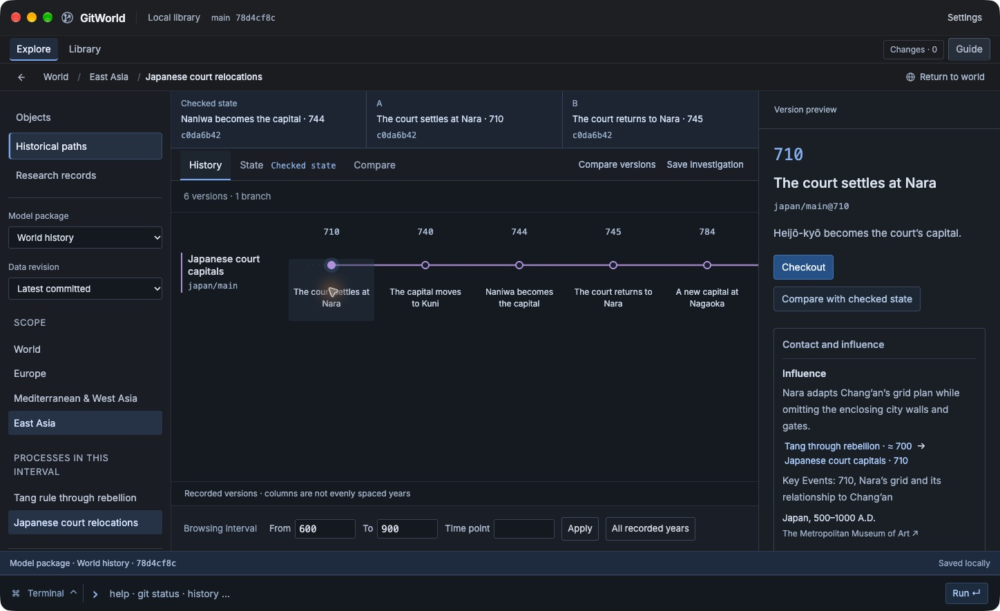
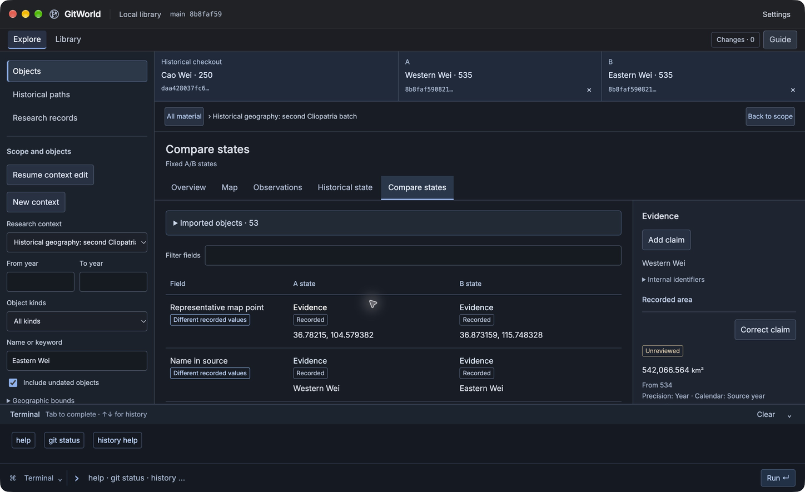
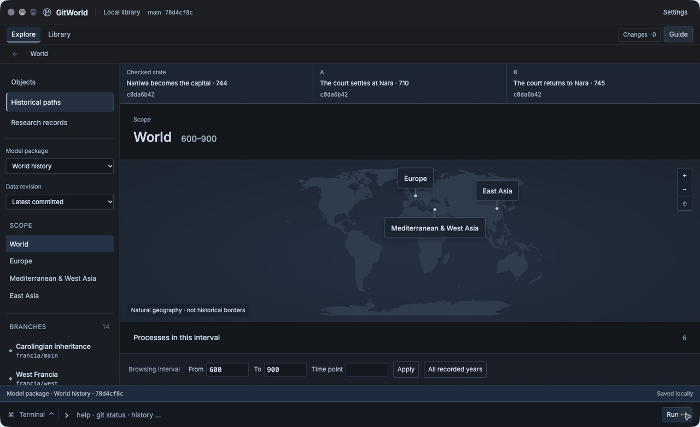
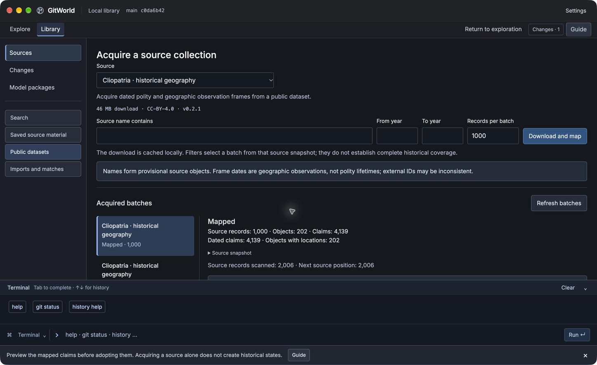

# GitWorld

A local workbench for learning history through states, branches and diffs.

Follow a historical path, compare what changed, and trace a field back to its evidence. GitWorld connects those investigations to a real Git repository: your corrections and research become modern data revisions, while historical dates keep their own meaning.

**English and Simplified Chinese · Local library · Bundled runtime and Git**

## Delivery status

**The installer release has not been published.** The images below show a **v0.1.6 pre-release build**. A staging-dependency defect is under correction, and complete installed acceptance remains pending. Git tags identify source revisions; **tags alone are not downloadable installers**.



*Pre-release workbench: six recorded Japanese court versions and a separately modeled Tang–Nara influence link. The authored model is limited to 14 paths and 38 recorded versions. [Capture details and attribution](docs/media/README.md).*

## From source material to an investigation

1. **Bring in material.** In **Library → Sources**, find an entity, acquire a bounded public dataset or save a fixed Wikipedia revision. Inspect the mapping, dates and exceptions before adopting it into **Working** data.
2. **Choose a scope.** In **Explore → Objects**, choose a research context, time window and kinds. Organize an entire acquired batch into a context. Context membership is a modern browsing aid, not a claim about historical borders or identity.
3. **Inspect and compare states.** Open an object, inspect a year and fix comparison endpoints A and B. Historical model paths also support checkout, splits and integration. Unknown fields stay unknown; recorded and requested dates remain distinct.
4. **Follow the evidence.** Inspect the supporting assertion, source revision and locator. Keep formal tenure separate from effective authority, and source table order separate from historical ancestry.
5. **Save an investigation.** Record a question, scope, fixed evidence and comparison, provisional interpretation and unresolved questions. Research records are your contributions; saving a note does not silently turn it into a historical fact.
6. **Review a modern revision.** Inspect Working changes, stage a selection and commit a reason. The index freezes that selection: later Working edits can remain for the next revision. The current staging-dependency correction must be completed before installer publication.

The in-app terminal uses the same typed services as the GUI. Guide offers optional next actions; Settings manages language, zoom, identity and complete-library backups.



*Two fixed Cliopatria-based states at 535. Recorded areas and date spans are source observations, not established polity lifetimes or reconstructed historical borders. [Details and attribution](docs/media/README.md#cliopatria-observations).*

### A still-frame walkthrough



*Four actual v0.1.6 captures, held for six seconds each in a 24-second loop. This is an edited **still-frame walkthrough**, not a continuous screen recording: it records no clicks or typing, and shows no acquisition timing. [Original screens and media notice](docs/media/README.md).*

## Source catalog

| Entry | What you can inspect |
| --- | --- |
| **Wikidata** | Name discovery and structured statements with source identity and review status. |
| **English Wikipedia** | A fixed page revision, actual tables and explicitly selected tenure or dated-entry columns. Mapping issues remain available for review. |
| **Cliopatria** | Bounded polity and geography observation frames. Their date spans do not establish canonical polity lifetimes. |
| **Pleiades** | Ancient place, name and location attestations from the official dataset. |
| **Local files** | Validated KnowledgeCollection imports and historical model packages in their supported formats. |

These entries map supported structures; they do not interpret arbitrary spreadsheets or turn an article into a complete chronology. Acquisition requires connectivity. Adopted local content remains available offline, without an application server, AI account, developer checkout or system Git.



*One actual 1,000-record batch produced 202 provisional objects and 4,139 dated claims. These are mapping results, not a count of reviewed historical facts or complete coverage. [Cliopatria credit and transformations](docs/media/README.md#cliopatria-observations).*

## What Git brings to history

A **historical state** describes what is recorded about the past. An object/year or model/ref is qualified by its data commit. Historical checkout and A/B stay fixed while you browse elsewhere; they do not move the repository HEAD.

A **data commit** records a present-day contribution to your library. Its timestamp is not an ancient event. Influence links are separate from ancestry, and a modern correction does not invent a new historical event.

The starter historical model makes these distinctions concrete: shared Carolingian history splits into three paths at Verdun in 843; Sui integration uses an explicit field-resolution ledger; a court's return to a city does not restore every earlier field.

```text
help
git status
scope contexts
history --model gitworld-curated-history --revision <commit-oid> diff sui/main@581 sui/main@589
```

Replace `<commit-oid>` with the data commit shown in the workbench. Completion and `history help` expose the supported commands. This terminal is a bounded application interface, not a system shell.

## Starting content and its limits

The bundled East Asia collection contains **1,219 objects, 4,023 claims and 24 source records**, centered on China and Japan with explicit gaps. Its claims start **unreviewed**. A separate authored model has **14 historical paths and 38 recorded versions**; it is neither the entire object collection nor complete world history.

GitWorld-authored starter presentation is available in English and Simplified Chinese. External material retains its source language and citations; arbitrary imports are not automatically translated. The modern basemap is a navigation reference, not a reconstruction of historical borders. See the [data guide](data/README.md), [source attribution](data/seed/east-asia/README.md) and [data operations](docs/data-operations.md).

## Platforms and installation work

| Target | Current scope |
| --- | --- |
| **macOS Apple Silicon** | Primary installer candidate; macOS 14 minimum. Complete installed acceptance is pending. |
| **macOS Intel** | Experimental native CI build and runtime checks; the complete GUI journey is unverified. |
| **Ubuntu 22.04 x64** | Experimental native CI build and runtime checks under Xvfb; other distributions and desktop sessions are unverified. |
| **Windows** | No delivered package. |

Current macOS candidates are **unsigned and unnotarized**. No installer download is being offered here yet. See the [distribution scope](docs/desktop-distribution-prd.md). A full `.gitworld` backup is a private recovery artifact, including acquired material and the repository's staged and Working state; see [backup behavior](docs/library-backup.md).

## Develop and contribute

Use Node.js 24 for the contributor workflow:

```sh
npm ci
npm run dev
```

The [desktop guide](apps/desktop/README.md) covers source checks, runtime checks and isolated packaging. Use [Issues](https://github.com/samar1tan/GitWorld/issues) for a concrete historical question, evidence correction or interaction problem. See [contributing](CONTRIBUTING.md), the [PRD](docs/PRD.md) and [UED](docs/UED.md).

The editable Figma design is retained. Its existing core frames are available; the additional current-flow updates still await synchronization. Neither those frames nor source tests establish final installed acceptance.

GitWorld code uses [Apache-2.0](LICENSE). Bundled software and data retain their own licenses and attribution; see [third-party notices](THIRD_PARTY_NOTICES.md). [Media notices](docs/media/README.md) identify capture, editing and source attribution.
